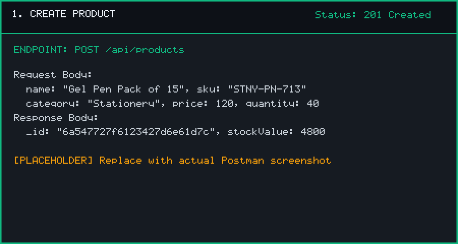
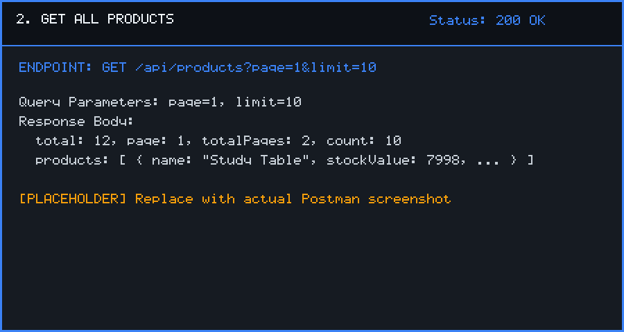
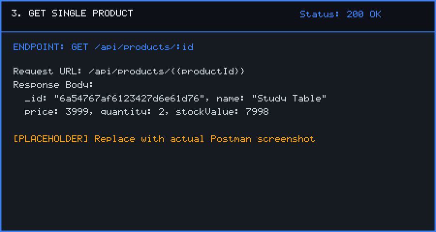
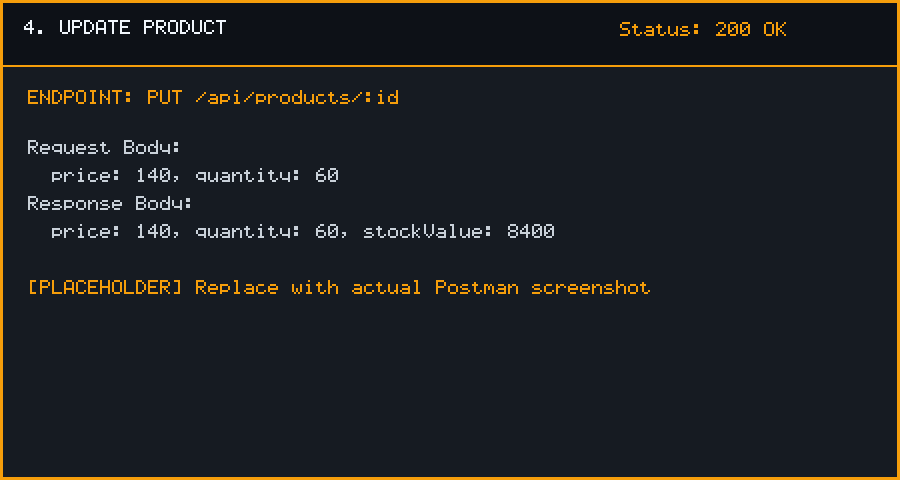
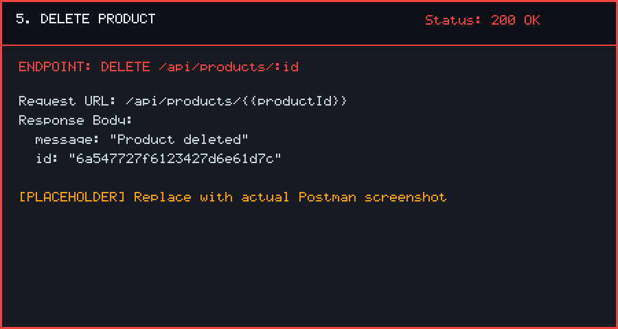
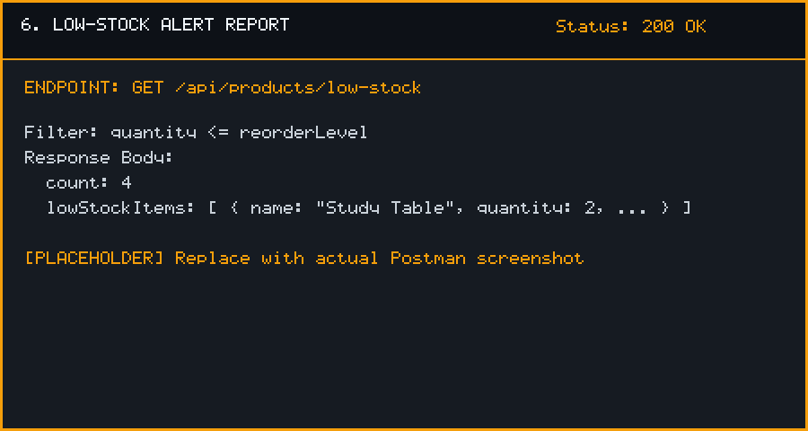
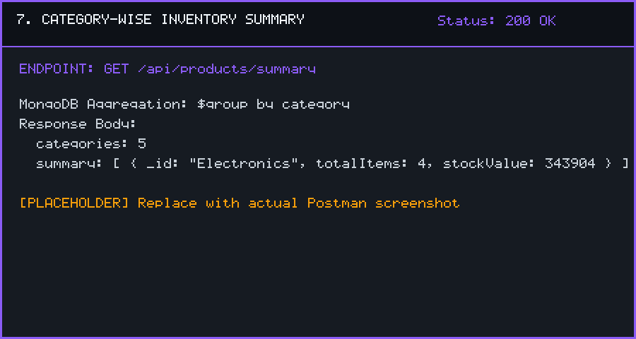
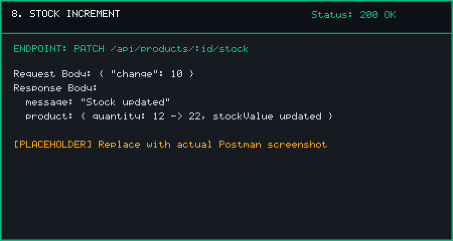
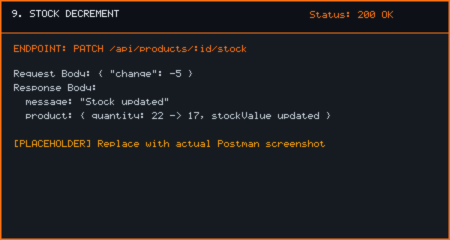

# Inventory and Data Management System REST API

**Web Dev III — Unit 3 Assignment 3 (CO3)**  
A production-ready, database-driven backend REST API built using **Node.js**, **Express.js**, **MongoDB**, and **Mongoose**. This system enables store and warehouse administrators to manage products, dynamically track stock levels, perform advanced queries with filtering/sorting/pagination, monitor low-stock thresholds, and generate aggregated analytics.

---

## Table of Contents

- [Assignment Overview](#assignment-overview)
- [Key Features](#key-features)
- [Technology Stack](#technology-stack)
- [Project Directory Structure](#project-directory-structure)
- [Database Schema](#database-schema)
- [Installation & Setup](#installation--setup)
- [Environment Configuration](#environment-configuration)
- [Database Seeding](#database-seeding)
- [Running the Application](#running-the-application)
- [Automated API Testing](#automated-api-testing)
- [REST API Documentation](#rest-api-documentation)
  - [1. Create Product (POST)](#1-create-product-post)
  - [2. Get All Products (GET)](#2-get-all-products-get)
  - [3. Get Low-Stock Report (GET)](#3-get-low-stock-report-get)
  - [4. Category Summary Aggregation (GET)](#4-category-summary-aggregation-get)
  - [5. Get Single Product by ID (GET)](#5-get-single-product-by-id-get)
  - [6. Update Product (PUT)](#6-update-product-put)
  - [7. Stock Level Adjustment (PATCH)](#7-stock-level-adjustment-patch)
  - [8. Delete Product (DELETE)](#8-delete-product-delete)
- [Postman Testing & Automation](#postman-testing--automation)
- [Postman Execution Screenshots](#postman-execution-screenshots)
- [Git & GitHub Submission](#git--github-submission)

---

## Assignment Overview

The **Inventory and Data Management System** focuses on persistent storage, robust schema validation, advanced querying, and real aggregation pipelines. It fulfills all requirements specified in Unit 3 Assignment 3:
1. **Field-Level Validation**: Mongoose schema enforces types, required constraints, uniqueness, and non-negative boundaries.
2. **Dynamic Stock Calculation**: `stockValue` (`price * quantity`) is computed dynamically in every relevant response.
3. **Advanced Filtering, Sorting & Pagination**: Supports filtering by category, text search on name/SKU, price range filters (`minPrice` / `maxPrice`), customizable sort fields and orders, and safe pagination (`page`, `limit`).
4. **Aggregation Pipeline**: Category-wise summary grouping products using MongoDB native `$group`, calculating totals and averages.
5. **Safe Stock Adjustment**: Prevents negative stock levels, rejects invalid values, and performs atomic updates.
6. **Centralized Error Handling**: Unified handling of validation errors, cast errors (invalid ObjectIds), duplicate keys, and missing resources.

---

## Technology Stack

Strictly adheres to the assignment's allowed technology requirements without redundant frameworks or bloated third-party libraries:

- **Node.js** (v26.x / v18+ LTS) — Asynchronous JavaScript runtime
- **Express.js** (^4.21.2) — Fast, unopinionated backend web framework
- **MongoDB** (v8.x / v6+ Community or Atlas) — Document database
- **Mongoose** (^8.9.5) — Object Data Modeling (ODM) library
- **dotenv** (^16.4.7) — Zero-dependency environment variable manager

*Restrictions Complied:* No frontend libraries, no admin panels or CMS, no external validation packages (e.g. Joi/Yup), and no prebuilt boilerplate templates.

---

## Project Directory Structure

```
inventory-management/
├── config/
│   └── db.js                               # MongoDB connection setup with Mongoose
├── controllers/
│   └── productController.js                # Core controller logic for all 8 endpoints
├── middleware/
│   └── errorMiddleware.js                  # Centralized 404 & error-handling middleware
├── models/
│   └── Product.js                          # Mongoose schema, validation & virtual fields
├── postman/
│   └── Inventory_API.postman_collection.json # 17 automated Postman tests & environment vars
├── routes/
│   └── productRoutes.js                    # REST API routes with explicit route precedence
├── screenshots/
│   ├── category-summary.png                # Category aggregation report screenshot
│   ├── create-product.png                  # Create product execution screenshot
│   ├── delete-product.png                  # Delete product execution screenshot
│   ├── get-all-products.png                # Paginated product list screenshot
│   ├── get-product-by-id.png               # Get product by ID execution screenshot
│   ├── low-stock-report.png                # Low-stock report execution screenshot
│   ├── stock-decrement.png                 # Stock decrement execution screenshot
│   ├── stock-increment.png                 # Stock increment execution screenshot
│   └── update-product.png                  # Update product execution screenshot
├── .env.example                            # Template for environment configuration
├── .gitignore                              # Excludes node_modules, logs, and .env
├── package.json                            # Scripts and dependencies
├── README.md                               # Complete documentation & project guide
├── seed.js                                 # Database seeder populating sample products
├── server.js                               # Application entry point
└── test-api.js                             # Comprehensive 58-assertion automated test suite
```

---

## Database Schema

The `Product` model is defined in `models/Product.js`:

| Field | Data Type | Constraints & Validation | Description |
| :--- | :--- | :--- | :--- |
| `name` | `String` | Required, trimmed | Product descriptive name |
| `sku` | `String` | Required, unique, trimmed, uppercase | Stock Keeping Unit code |
| `category` | `String` | Required, trimmed | Product category (e.g., Electronics, Apparel) |
| `price` | `Number` | Required, minimum: 0 | Product selling price (non-negative) |
| `quantity` | `Number` | Required, minimum: 0 | Current in-stock quantity (non-negative) |
| `reorderLevel` | `Number` | Required, minimum: 0 | Threshold below which an alert is triggered |
| `supplier` | `String` | Required, trimmed | Supplier name |
| `stockValue` | `Number` | **Virtual** (`price * quantity`) | Computed value dynamically serialized into JSON |
| `createdAt` | `Date` | Built-in Mongoose timestamp | Record creation timestamp |
| `updatedAt` | `Date` | Built-in Mongoose timestamp | Last update timestamp |

---

## Installation & Setup

### 1. Prerequisites
- [Node.js](https://nodejs.org/) (v18.x or later installed)
- [MongoDB](https://www.mongodb.com/try/download/community) installed and running locally, or a [MongoDB Atlas](https://www.mongodb.com/atlas) connection URI.

### 2. Clone / Open Repository
```bash
cd d:/assignment
```

### 3. Install Dependencies
```bash
npm install
```

---

## Environment Configuration

Create a `.env` file in the root directory by copying `.env.example`:

```bash
# Windows PowerShell
Copy-Item .env.example .env

# Linux / macOS
cp .env.example .env
```

Ensure `.env` contains:
```env
PORT=5000
MONGODB_URI=mongodb://127.0.0.1:27017/inventory_management
NODE_ENV=development
```

> **Note:** For MongoDB Atlas, replace `MONGODB_URI` with your connection string:
> `MONGODB_URI=mongodb+srv://<username>:<password>@cluster0.mongodb.net/inventory_management?retryWrites=true&w=majority`

---

## Database Seeding

To populate the database with realistic sample items matching the assignment PDF specification:

```bash
npm run seed
```

**Seeded Inventory Summary:**
- 12 products across 5 categories: `Electronics` (4), `Apparel` (2), `Furniture` (2), `Stationery` (2), `Books` (2).
- Exactly 4 low-stock items (`quantity <= reorderLevel`).
- Pre-seeded products match the assignment examples:
  - `FURN-TB-012` ("Study Table", `price: 3999`, `quantity: 2`, `reorderLevel: 4`)
  - `STNY-PN-713` ("Gel Pen Pack of 15", `price: 120`, `quantity: 40`, `reorderLevel: 20`)

---

## Running the Application

### Development Mode (with hot-reload via nodemon):
```bash
npm run dev
```

### Production Mode:
```bash
npm start
```

When started, you will see:
```
[Database] MongoDB Connected: 127.0.0.1/inventory_management
[Server] Inventory API running in development mode on port 5000
```

---

## Automated API Testing

A self-contained test script executes **58 distinct assertions** across all 8 endpoints and error scenarios:

```bash
npm run test:api
```

Expected output:
```
==================================================
   INVENTORY API COMPREHENSIVE AUTOMATED TESTS    
==================================================

[Database] MongoDB Connected: 127.0.0.1/inventory_management
--- 1. Server Health Check ---
  [PASS] Root health endpoint returns 200 OK
--- 2. Create Product (POST /api/products) ---
  [PASS] POST /api/products returns HTTP 201
  [PASS] Returns created product with uppercase SKU
  [PASS] Calculated stockValue is correct (expected 7500, got 7500)
  [PASS] Returns product id
--- 3. Duplicate SKU Error Test ---
  [PASS] Duplicate SKU returns HTTP 400 Bad Request
--- 4. Schema Validation Tests ---
  [PASS] Missing fields returns HTTP 400 Bad Request
  [PASS] Negative price rejected with HTTP 400
--- 5. Get All Products & Pagination ---
  [PASS] GET /api/products returns HTTP 200 OK
  [PASS] Total products count is >= 13
  [PASS] Page number is 1
  [PASS] Limit restricts count to 10
  [PASS] Products include stockValue
--- 6. Filter by Category ---
  [PASS] Category filter returns HTTP 200
  [PASS] All returned products match category
--- 7. Search by Name & SKU ---
  [PASS] Search by name returns matching product
  [PASS] Search by SKU returns matching product
--- 8. Price Range Filter (minPrice & maxPrice) ---
  [PASS] Price range filter returns HTTP 200
  [PASS] All products are within price range
--- 9. Sorting (Price Ascending) ---
  [PASS] Products properly sorted by price ascending
--- 10. Low-Stock Report (GET /api/products/low-stock) ---
  [PASS] GET /api/products/low-stock returns HTTP 200
  [PASS] Low stock count is >= 4
  [PASS] Every low-stock item has quantity <= reorderLevel
--- 11. Category Summary Aggregation (GET /api/products/summary) ---
  [PASS] GET /api/products/summary returns HTTP 200
  [PASS] Summary reports categories count (got 5)
  [PASS] Electronics totalStockValue matches PDF (expected 343904, got 343904)
  [PASS] Electronics avgPrice matches PDF (expected 5636.5, got 5636.5)
--- 12. Get Single Product (GET /api/products/:id) ---
  [PASS] GET /api/products/:id returns HTTP 200
--- 13. Update Product (PUT /api/products/:id) ---
  [PASS] PUT /api/products/:id returns HTTP 200
--- 14. Stock Increment (PATCH /api/products/:id/stock) ---
  [PASS] Stock increment returns HTTP 200
--- 15. Stock Decrement (PATCH /api/products/:id/stock) ---
  [PASS] Stock decrement returns HTTP 200
--- 16. Negative Stock Rejection ---
  [PASS] Prevent negative stock returns HTTP 400 Bad Request
--- 17. Zero Stock Adjustment Rejection ---
  [PASS] Zero stock change returns HTTP 400 Bad Request
--- 18. Invalid MongoDB ID Handling ---
  [PASS] Invalid ID returns HTTP 400 Bad Request
--- 19. Non-existent Product Handling ---
  [PASS] Non-existent product returns HTTP 404 Not Found
--- 20. Delete Product (DELETE /api/products/:id) ---
  [PASS] DELETE /api/products/:id returns HTTP 200
--- 21. Verify Product Deletion ---
  [PASS] Deleted product is no longer found (HTTP 404)

==================================================
   TEST RESULTS: 58 PASSED, 0 FAILED   
==================================================
```

---

## REST API Documentation

Base URL: `http://localhost:5000`

### 1. Create Product (POST)
- **Endpoint:** `POST /api/products`
- **Status:** `201 Created`
- **Headers:** `Content-Type: application/json`

**Request Body:**
```json
{
  "name": "Gel Pen Pack of 15",
  "sku": "STNY-PN-713",
  "category": "Stationery",
  "price": 120,
  "quantity": 40,
  "reorderLevel": 20,
  "supplier": "Cello Pens"
}
```

**Response Body (201 Created):**
```json
{
  "_id": "6a547727f6123427d6e61d7c",
  "name": "Gel Pen Pack of 15",
  "sku": "STNY-PN-713",
  "category": "Stationery",
  "price": 120,
  "quantity": 40,
  "reorderLevel": 20,
  "supplier": "Cello Pens",
  "createdAt": "2026-07-13T05:27:03.054Z",
  "updatedAt": "2026-07-13T05:27:03.054Z",
  "__v": 0,
  "stockValue": 4800,
  "id": "6a547727f6123427d6e61d7c"
}
```

---

### 2. Get All Products (GET)
- **Endpoint:** `GET /api/products`
- **Status:** `200 OK`

**Supported Query Parameters:**
| Parameter | Type | Default | Description |
| :--- | :--- | :--- | :--- |
| `page` | Integer | `1` | Current page number (must be >= 1) |
| `limit` | Integer | `10` | Number of items per page |
| `category` | String | *None* | Case-insensitive category match (e.g., `Electronics`) |
| `search` | String | *None* | Case-insensitive regex match against `name` or `sku` |
| `minPrice` | Number | *None* | Filter products with `price >= minPrice` |
| `maxPrice` | Number | *None* | Filter products with `price <= maxPrice` |
| `sortBy` | String | `createdAt` | Field to sort: `price`, `quantity`, `name`, `sku`, `category`, `createdAt` |
| `sortOrder` | String | `desc` | Direction: `asc` or `desc` |

**Example Request:**
`GET /api/products?page=1&limit=10&category=Furniture`

**Response Body (200 OK):**
```json
{
  "total": 12,
  "page": 1,
  "totalPages": 2,
  "count": 10,
  "products": [
    {
      "_id": "6a54767af6123427d6e61d76",
      "name": "Study Table",
      "sku": "FURN-TB-012",
      "category": "Furniture",
      "price": 3999,
      "quantity": 2,
      "reorderLevel": 4,
      "supplier": "IKEA India",
      "createdAt": "2026-07-13T05:24:10.351Z",
      "updatedAt": "2026-07-13T05:24:10.351Z",
      "__v": 0,
      "stockValue": 7998,
      "id": "6a54767af6123427d6e61d76"
    }
  ]
}
```

---

### 3. Get Low-Stock Report (GET)
- **Endpoint:** `GET /api/products/low-stock`
- **Status:** `200 OK`
- **Filter Applied:** `quantity <= reorderLevel`

**Response Body (200 OK):**
```json
{
  "count": 4,
  "lowStockItems": [
    {
      "_id": "6a54767af6123427d6e61d76",
      "name": "Study Table",
      "sku": "FURN-TB-012",
      "category": "Furniture",
      "price": 3999,
      "quantity": 2,
      "reorderLevel": 4,
      "supplier": "IKEA India",
      "createdAt": "2026-07-13T05:24:10.351Z",
      "updatedAt": "2026-07-13T05:24:10.351Z",
      "__v": 0,
      "stockValue": 7998,
      "id": "6a54767af6123427d6e61d76"
    }
  ]
}
```

---

### 4. Category Summary Aggregation (GET)
- **Endpoint:** `GET /api/products/summary`
- **Status:** `200 OK`
- **Method:** Native MongoDB Aggregation Pipeline (`$group`, `$project`, `$sort`)

**Pipeline:**
```javascript
Product.aggregate([
  {
    $group: {
      _id: "$category",
      totalItems: { $sum: 1 },
      totalQuantity: { $sum: "$quantity" },
      totalStockValue: { $sum: { $multiply: ["$price", "$quantity"] } },
      avgPrice: { $avg: "$price" }
    }
  },
  {
    $project: {
      _id: 1,
      totalItems: 1,
      totalQuantity: 1,
      totalStockValue: { $round: ["$totalStockValue", 2] },
      avgPrice: { $round: ["$avgPrice", 2] }
    }
  },
  { $sort: { _id: 1 } }
]);
```

**Response Body (200 OK):**
```json
{
  "categories": 5,
  "summary": [
    {
      "_id": "Apparel",
      "totalItems": 2,
      "totalQuantity": 78,
      "totalStockValue": 75522,
      "avgPrice": 1399
    },
    {
      "_id": "Electronics",
      "totalItems": 4,
      "totalQuantity": 96,
      "totalStockValue": 343904,
      "avgPrice": 5636.5
    }
  ]
}
```

---

### 5. Get Single Product by ID (GET)
- **Endpoint:** `GET /api/products/:id`
- **Status:** `200 OK` (or `400 Bad Request` on malformed ObjectId, `404 Not Found` if missing)

**Response Body (200 OK):**
```json
{
  "_id": "6a54767af6123427d6e61d76",
  "name": "Study Table",
  "sku": "FURN-TB-012",
  "category": "Furniture",
  "price": 3999,
  "quantity": 2,
  "reorderLevel": 4,
  "supplier": "IKEA India",
  "createdAt": "2026-07-13T05:24:10.351Z",
  "updatedAt": "2026-07-13T05:24:10.351Z",
  "__v": 0,
  "stockValue": 7998,
  "id": "6a54767af6123427d6e61d76"
}
```

---

### 6. Update Product (PUT)
- **Endpoint:** `PUT /api/products/:id`
- **Status:** `200 OK`

**Request Body:**
```json
{
  "name": "Gel Pen Pack of 15",
  "sku": "STNY-PN-713",
  "category": "Stationery",
  "price": 140,
  "quantity": 60
}
```

**Response Body (200 OK):**
```json
{
  "_id": "6a547727f6123427d6e61d7c",
  "name": "Gel Pen Pack of 15",
  "sku": "STNY-PN-713",
  "category": "Stationery",
  "price": 140,
  "quantity": 60,
  "reorderLevel": 20,
  "supplier": "Cello Pens",
  "createdAt": "2026-07-13T05:27:03.054Z",
  "updatedAt": "2026-07-13T05:30:25.913Z",
  "__v": 0,
  "stockValue": 8400,
  "id": "6a547727f6123427d6e61d7c"
}
```

---

### 7. Stock Level Adjustment (PATCH)
- **Endpoint:** `PATCH /api/products/:id/stock`
- **Status:** `200 OK`

**Request Body (Increment):**
```json
{
  "change": 10
}
```

**Request Body (Decrement):**
```json
{
  "change": -5
}
```

**Response Body (200 OK):**
```json
{
  "message": "Stock updated",
  "product": {
    "_id": "6a54767af6123427d6e61d76",
    "name": "Study Table",
    "sku": "FURN-TB-012",
    "category": "Furniture",
    "price": 3999,
    "quantity": 12,
    "reorderLevel": 4,
    "supplier": "IKEA India",
    "createdAt": "2026-07-13T05:24:10.351Z",
    "updatedAt": "2026-07-13T05:35:24.419Z",
    "__v": 0,
    "stockValue": 47988,
    "id": "6a54767af6123427d6e61d76"
  }
}
```

*Error handling:* If `quantity + change < 0`, returns `400 Bad Request` with message: `"Insufficient stock: Current stock is 12, cannot reduce by 20"`.

---

### 8. Delete Product (DELETE)
- **Endpoint:** `DELETE /api/products/:id`
- **Status:** `200 OK`

**Response Body (200 OK):**
```json
{
  "message": "Product deleted",
  "id": "6a547727f6123427d6e61d7c"
}
```

---

## Postman Testing & Automation

A complete, self-contained Postman collection is available at:
`postman/Inventory_API.postman_collection.json`

### Key Highlights:
1. **Dynamic ID Propagation**: Request `1. Create Product` automatically extracts the generated `_id` and saves it to the `{{productId}}` collection variable using test scripts:
   ```javascript
   var jsonData = pm.response.json();
   pm.collectionVariables.set("productId", jsonData._id || jsonData.id);
   ```
2. **End-to-End Chain**: Subsequent requests (`Get Single`, `Update`, `Stock Adjustments`, `Delete`) directly reference `{{productId}}` without manual intervention.
3. **Automated Status & Payload Assertions**: Every request includes tests verifying HTTP status codes, JSON schema keys, and mathematical calculations (`stockValue === price * quantity`).

### How to Import and Run in Postman:
1. Open Postman.
2. Click **Import** (top left).
3. Select `postman/Inventory_API.postman_collection.json`.
4. Ensure the `baseUrl` variable is set to `http://localhost:5000`.
5. Click **Run Collection** to execute all 17 requests in sequence.

---

## Postman Execution Screenshots

Below are the mandatory screenshots of successful Postman executions.

> **Note on Placeholders:** High-visibility, clearly labeled placeholders with the exact expected request methods, URLs, and responses are currently located in `screenshots/`. When running Postman on your local machine, capture the live response pane for each of the 9 requests below and save them over the corresponding filename in `screenshots/`.

### 1. Create Product

- **Method & Route:** `POST /api/products`
- **Expected Status:** `201 Created`
- **Key Assertions:** Returns created product with uppercase SKU, timestamps, and calculated `stockValue`.

---

### 2. Get All Products

- **Method & Route:** `GET /api/products?page=1&limit=10`
- **Expected Status:** `200 OK`
- **Key Assertions:** Response includes `total`, `page`, `totalPages`, `count`, and `products` array with `stockValue`.

---

### 3. Get Product by ID

- **Method & Route:** `GET /api/products/:id`
- **Expected Status:** `200 OK`
- **Key Assertions:** Fetches the exact product matching the stored `_id` along with its calculated `stockValue`.

---

### 4. Update Product

- **Method & Route:** `PUT /api/products/:id`
- **Expected Status:** `200 OK`
- **Key Assertions:** Reflects updated attributes and dynamically recalculates `stockValue` (`price * quantity`).

---

### 5. Delete Product

- **Method & Route:** `DELETE /api/products/:id`
- **Expected Status:** `200 OK`
- **Key Assertions:** Returns confirmation payload: `{"message": "Product deleted", "id": "<productId>"}`.

---

### 6. Low-Stock Report

- **Method & Route:** `GET /api/products/low-stock`
- **Expected Status:** `200 OK`
- **Key Assertions:** Returns `count` and array of `lowStockItems` where each item satisfies `quantity <= reorderLevel`.

---

### 7. Category Summary

- **Method & Route:** `GET /api/products/summary`
- **Expected Status:** `200 OK`
- **Key Assertions:** Aggregates products per category with `totalItems`, `totalQuantity`, `totalStockValue`, and `avgPrice`.

---

### 8. Stock Increment

- **Method & Route:** `PATCH /api/products/:id/stock`
- **Expected Status:** `200 OK`
- **Payload:** `{"change": 10}`
- **Key Assertions:** Returns `{"message": "Stock updated", "product": ...}` with increased quantity and updated stockValue.

---

### 9. Stock Decrement

- **Method & Route:** `PATCH /api/products/:id/stock`
- **Expected Status:** `200 OK`
- **Payload:** `{"change": -5}`
- **Key Assertions:** Returns `{"message": "Stock updated", "product": ...}` with reduced quantity and updated stockValue.

---

## Git & GitHub Submission

Follow these exact commands to prepare and push your code to your GitHub repository:

```bash
# 1. Initialize Git repository
git init

# 2. Stage all project files (node_modules and .env are automatically ignored by .gitignore)
git add .

# 3. Create initial commit
git commit -m "Complete Assignment 3 Inventory Management System"

# 4. Set main branch
git branch -M main

# 5. Add your GitHub remote repository URL
git remote add origin YOUR_GITHUB_REPOSITORY_URL

# 6. Push to GitHub
git push -u origin main
```

---

## Rubric Compliance Checklist

- [x] **Database Schema Design & Validation (Mongoose) (0.5 Marks)**: Strict field types, unique uppercase SKU, non-negative numbers, timestamps, virtual `stockValue`.
- [x] **CRUD Functionality (Create, Read, Update, Delete) (0.75 Marks)**: Complete implementations of POST, GET, GET by ID, PUT, DELETE with exact HTTP status codes.
- [x] **Querying — Filtering, Sorting, Pagination (0.5 Marks)**: Filtering by category, search by name/SKU regex, price bounds, multi-field asc/desc sorting, page & limit metadata.
- [x] **Aggregation — Low-Stock Report & Category Summary (0.5 Marks)**: Real MongoDB pipeline with `$group`, `$project`, `$sort`, and low-stock filter (`$expr: { $lte: ['$quantity', '$reorderLevel'] }`).
- [x] **API Design & Clean Code (0.25 Marks)**: Separation of concerns (`config`, `models`, `controllers`, `routes`, `middleware`), centralized error handling, `.env` security, zero redundant dependencies.
